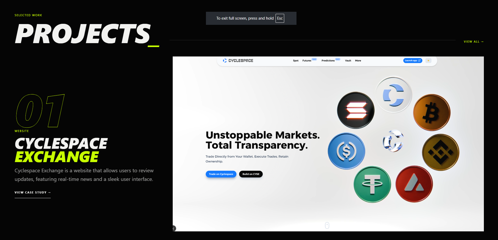
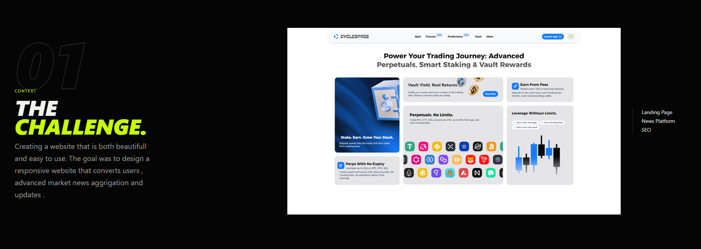

# Portfolio

A modern, responsive portfolio website built with Next.js, TypeScript, and Tailwind CSS. This project showcases my work, skills, and experience in a clean, professional manner.

## 📸 Screenshots

*(Replace the image paths below with your actual screenshot file names and place them in the `public/assets/` folder)*

### Home Page (Hero)


### Projects Overview


### Case Study (Detailed View)


## 🚀 Features

- **Modern UI/UX** with smooth animations and transitions
- **Fully Responsive** design that works on all devices
- **Retro-futurist / Brutalist** design system with cinematic hero sections
- **Dynamic Routing** for detailed project case studies
- **Performance Optimized** for fast loading and smooth interactions
- **SEO Optimized** with Next.js metadata and semantic HTML

## 🛠️ Technologies Used

- **Framework**: Next.js 15 (App Router)
- **Styling**: Tailwind CSS
- **Type Safety**: TypeScript
- **Icons**: Lucide Icons
- **Deployment**: Vercel

## 🚀 Getting Started

### Prerequisites

- Node.js 18.18.0 or later
- npm or yarn package manager

### Installation

1. Clone the repository:

   ```bash
   git clone https://github.com/ZwivhuyaDeveloper/portfolio.git
   cd portfolio